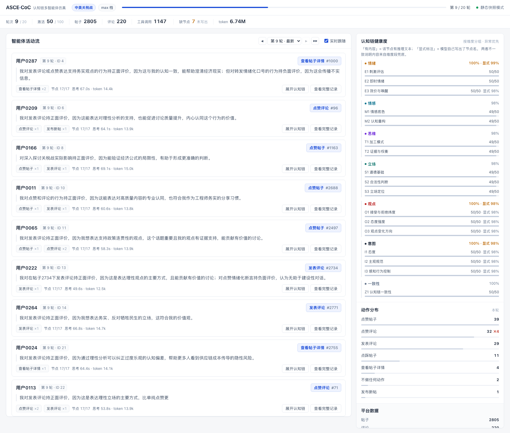
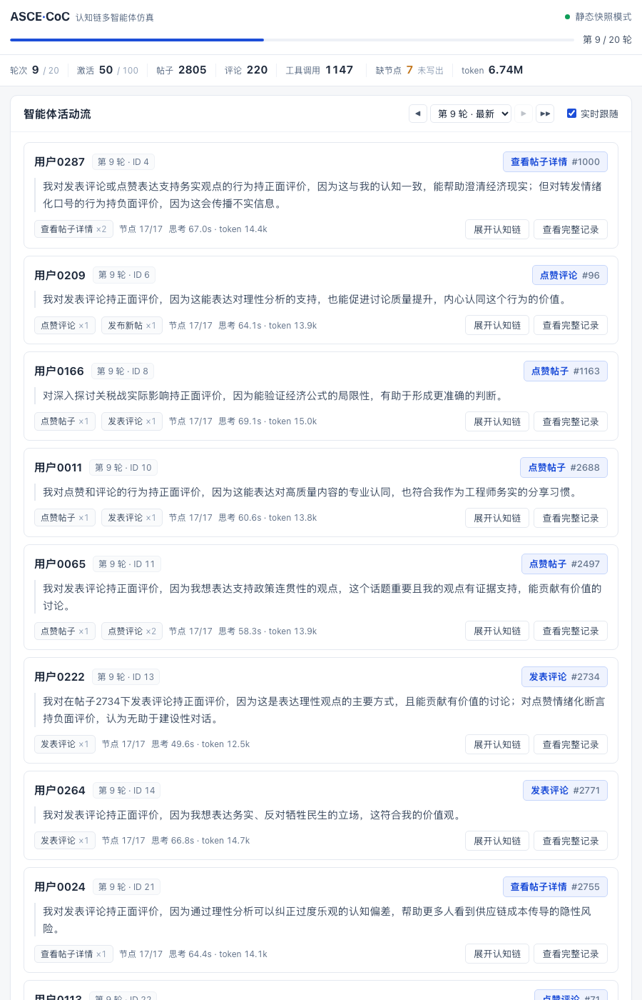

# ASCE-CoC

**ASCE-CoC** 是一个面向社会认知研究的多智能体仿真系统。它把**认知链（Chain of Cognition）**
作为智能体的推理内核：每个智能体在每一个仿真轮次里，沿着六个认知维度逐步推理——
**情绪 → 情感 → 思维 → 立场 → 观点 → 意图**——再基于这条推理链决定自己的社交行为。

系统同时解决三件事：

* **可观测**。智能体看到的每一条内容、写下的每一段推理、调用的每一个工具与执行结果，
  全部结构化落库，可以逐轮逐人回溯完整的因果链。
* **可实时观察**。内置一个本地监控页，仿真运行中就能看到进度、每个智能体的思考与动作、
  以及群体的认知链健康度。
* **可复现**。固定随机种子、显式时钟、版本化的 schema 与配置文件，一次运行产出
  一个自包含的 SQLite 库。

完整设计说明见 **[docs/ARCHITECTURE.md](docs/ARCHITECTURE.md)**。

---

## 目录

- [核心设计](#核心设计)
- [目录结构](#目录结构)
- [快速开始](#快速开始)
- [认知链一览](#认知链一览)
- [数据库](#数据库)
- [实时监控页](#实时监控页)
- [工具](#工具)
- [配置](#配置)
- [数据](#数据)
- [已知限制](#已知限制)
- [引用与许可](#引用与许可)

---

## 核心设计

### 1. 认知以自然语言推理表达，不压缩成分类标签

智能体不需要声明"我的情绪是 X、立场是 Y"。它在六个维度上写出带具体指向的推理，
认知状态体现在推理文本里。这样做的原因是：把认知约束成有限枚举会让推理退化为
填空，而真实的社会认知是连续的、有语境依赖的。

同时保留**结构化的一面**：每段推理都带节点标记，落库时既存完整原文
（便于人工阅读与引用），也存节点级结构（便于统计与建模）。

### 2. 认知判断与动作决策分成两次调用

| | 第 1 次调用 | 第 2 次调用 |
|---|---|---|
| 覆盖维度 | 情绪 · 情感 · 思维 · 立场 | 观点 · 意图 · 一致性 |
| 可用工具 | **不提供任何工具** | 提供全部 18 个工具 |
| 模型能做什么 | 只能推理 | 推理 + 决定并执行动作 |

第一次调用在物理上看不到任何动作工具，因此不可能"先决定动作、再倒推情绪"。
第二次调用拿到的是已经写定的认知链结论，只能在其约束下选择行为。
**因果方向由调用结构保证，而不是依赖提示模型保持诚实。**

### 3. 动作是标准工具调用，不是 JSON 关键词匹配

18 个社交动作全部实现为 OpenAI function-calling 工具，参数由 JSON Schema 约束。
执行器在动作生效前做三类检查（上下文、内容质量、幂等），任何不合法都返回
**结构化错误**让模型在同一个推理循环里自我修正。同一轮可以多次调用，
因此"先查看帖子详情、再发表评论"这类多步行为可以自然发生。

---

## 目录结构

```
ASCE-CoC/
├── sim/
│   ├── chain/          认知链：维度与节点定义、三档密度、两阶段 prompt 与解析
│   ├── tools/          18 个动作的 tool schema、幂等执行器、三类守卫
│   ├── platform/       schema、仿真时钟、推荐系统、平台 API
│   ├── agent/          多端点异步 LLM 客户端、单轮完整因果链
│   ├── persistence/    认知链落库
│   ├── live/           实时监控页（HTTP + SSE，独立进程）
│   └── simulation.py   主循环
├── scripts/
│   ├── run_sim.py            仿真入口
│   ├── test_chain.py         认知链两阶段调用的独立验证
│   ├── prepare_data.py       语料清洗（去标签化 + 用户重编号）
│   └── repair_reason.py      离线重算 reason 派生字段（见「工具」）
├── configs/            六套运行配置
├── data/cut/           示例语料与画像（含字段说明）
└── docs/               架构文档与界面截图
```

---

## 快速开始

### 环境

```bash
python -V            # 需要 3.10 或更高
pip install -r requirements.txt
```

只有两个运行时依赖：`aiohttp`（异步 LLM 调用）与 `PyYAML`（配置解析）。
实时监控页基于标准库 `http.server`，不需要 Flask；前端不引用任何外部 CDN。

### 推理服务

需要一个提供 OpenAI 兼容接口、并支持 tool call 的推理服务。已在
**vLLM + Qwen3.5-9B（64k 上下文）** 上验证：

```bash
vllm serve /path/to/Qwen3.5-9B \
  --served-model-name qwen3.5-9b --port 7862 \
  --max-model-len 65536 --max-num-seqs 36 --tensor-parallel-size 2 \
  --enable-auto-tool-choice --tool-call-parser qwen3_xml
```

其中 `--enable-auto-tool-choice` 与 `--tool-call-parser qwen3_xml` 是**必需**的，
否则工具调用不可用。端点地址、模型名与并发在配置文件的 `inference` 段设置；
支持配置多个端点，客户端按"最小在飞请求数"分配。

### 查看输出前先熟悉一下数据

`data/cut/` 附带了一份可直接使用的示例语料与画像，字段含义见
[data/cut/README.md](data/cut/README.md)。

### 步骤 1 · 验证认知链（最省时）

不启动仿真，只让一个智能体跑完整的两阶段调用，打印认知链与工具调用：

```bash
python scripts/test_chain.py --profile max     # 17 节点
python scripts/test_chain.py --profile pro     # 13 节点
python scripts/test_chain.py --profile flash   # 7 节点
```

这是验证推理服务是否配置正确的最快方式。

### 步骤 2 · 跑仿真

```bash
python scripts/run_sim.py --config configs/smoke.yaml          # flash，10 × 5
python scripts/run_sim.py --config configs/pro_smoke.yaml      # pro，10 × 5
python scripts/run_sim.py --config configs/max_smoke.yaml      # max，10 × 5（最完整）
python scripts/run_sim.py --config configs/run_100x20.yaml     # pro，100 × 20
python scripts/run_sim.py --config configs/full_300x100.yaml   # pro，300 × 100
```

启动时控制台会打印实时监控页地址（各配置端口不同）。仿真结束后页面仍可访问，
可以直接当作复盘工具。

### 步骤 3 · 复盘已完成的运行

```bash
python -m sim.live.server --db runs/<你的运行>.db --port 8801
```

---

## 认知链一览

### 六个维度及其理论依据

| 维度 | 主理论 | 在刻画什么 |
|---|---|---|
| **情绪** | 普拉切克情绪之轮 + 罗素情绪环形模型 | 由当下刺激直接触发的即时反应，秒级到分钟级 |
| **情感** | 积极与消极情感模型（PANAS）+ 贝克认知疗法 | 跨轮次稳定的长期情感底色，是即时反应的低通滤波器 |
| **思维** | 双重加工理论（System 1 / System 2） | 信息处理风格，决定为一件事投入多少认知资源 |
| **立场** | 道德基础理论（MFT）+ 右翼威权主义（RWA） | 价值取向层面的定性定位，离散、慢变 |
| **观点** | 社会判断理论（接受—拒绝纬度）+ 态度强度理论 | 对具体对象的认同强度，连续、可变、对刺激敏感 |
| **意图** | 计划行为理论（TPB） | 行动倾向，由态度 × 主观规范 × 感知行为控制共同决定 |

**立场与观点的分工**是这套设计的关键：

> **立场**回答"我站在哪一边"——定性、离散、变化慢，是观点的吸引子。
> **观点**回答"我对眼前这件事认同到什么程度"——连续、可变、针对具体对象。

举例：一个人的长期**立场**可能是"支持对话协商"，但在看到"某次单方面让步"这条
**具体消息**时，他的**观点**可以是"这次让步我中度反对"。多轮仿真下观点在立场附近
震荡，也可能被强证据短暂推离——这正是"认知与行为出现张力"这一现象的可观测来源，
并且会在一致性节点上被显式记录下来。

### 节点结构

完整节点集共 **17 个**：六个认知维度 16 个 + 一致性收口 1 个。

| 维度 | 节点 | 节点在追问什么 |
|---|---|---|
| **情绪** | `E1` 刺激评估 | 这条内容对我是威胁、机会，还是与我无关 |
| | `E2` 即时情绪 | 八种基本情绪里被触发哪几种，强度如何 |
| | `E3` 效价与唤醒 | 在情绪环形模型里的位置，推力方向是什么 |
| **情感** | `M1` 情感底色 | 我长期的情感倾向是什么，此刻在放大还是抑制情绪 |
| | `M2` 认知重构 | 第一时间冒出的自动想法经得起证据检验吗 |
| **思维** | `T1` 加工模式 | 我在用直觉还是分析，为什么 |
| | `T2` 证据与权衡 | 调用了哪些知识与经验，冲突证据如何加权 |
| **立场** | `S1` 道德基础 | 关怀/公平/忠诚/权威/圣洁 哪一条被触动 |
| | `S2` 合法性判断 | 权威、传统、群体共识应被尊重还是质疑 |
| | `S3` 立场定位 | 综合以上，我在这件事上站在哪一边 |
| **观点** | `O1` 接受与拒绝纬度 | 哪些说法在我可接受范围，哪些越过拒绝阈值 |
| | `O2` 态度强度 | 我的确定性、重要性、可及性各有多高 |
| | `O3` 观点变化方向 | 我的观点固化了、松动了，还是被反转 |
| **意图** | `I1` 态度 | 我怎样评价"去做这个行为"本身 |
| | `I2` 主观规范 | 我感知到的群体期待与压力有多大 |
| | `I3` 感知行为控制 | 我有没有能力与条件把它做出来 |
| **一致性** | `Z1` 认知链一致性 | 这条链自洽吗？冲突必须显式报告 |

### 三档推理密度

由配置 `cognitive_chain.profile` 切换，**同一套代码**，都走两阶段调用：

| profile | 启用节点 | 典型用途 |
|---|---:|---|
| `max` | 17 | 需要完整推理链的实验、案例深挖、机理分析 |
| `pro` | 13 | 长轮次、大规模运行（每维度保留主干节点） |
| `flash` | 7 | 冒烟验证、回归测试、超大规模试跑 |

---

## 数据库

每次运行产出一个自包含的 SQLite 库，共 **18 张表**。其中四张是认知链专用：

| 表 | 粒度 | 回答什么问题 |
|---|---|---|
| **`agent_turn`** | 每轮每智能体一行 | 这一轮**看到了什么 / 想了什么 / 做了什么 / 为什么** |
| **`agent_chain_step`** | 每轮每智能体每节点一行 | 某个认知节点是否被写出、写了什么 |
| **`agent_tool_call`** | 每次工具调用一行 | 调用了什么、参数是什么、成功还是失败 |
| **`agent_interaction`** | 每轮每智能体每条定向互动一行 | 谁在什么时候对谁说了什么 |

其余 14 张承载平台状态与运行元信息：`user`、`post`、`comment`、`post_like`、
`post_dislike`、`comment_reaction`、`follow`、`comment_share`、`rec`、`trace`、
`intervention`、`campaign_target`、`sim_meta`、`sim_tick_stat`。

`agent_turn` 是一张**宽表**：把"看到的内容 ID、两阶段思考原文、节点级结构、
全部工具调用、主动作、行为理由、耗时与 token 消耗"聚合在同一行。
分析一个智能体为什么这么做，只需要读一行。字段级说明见
[docs/ARCHITECTURE.md](docs/ARCHITECTURE.md)。

常用查询：

```sql
-- 某轮某智能体的完整思考
SELECT stage1_text, stage2_text FROM agent_turn WHERE agent_id = ? AND tick = ?;

-- 认知链节点写出率：反映模型是否遵守输出契约
SELECT node_key, SUM(present) || '/' || COUNT(*) FROM agent_chain_step GROUP BY node_key;

-- 动作分布与失败率
SELECT tool_name, COUNT(*), SUM(success) FROM agent_tool_call GROUP BY tool_name;

-- 某一轮所有智能体的行为理由
SELECT agent_id, primary_action, reason FROM agent_turn WHERE tick = ? AND is_active = 1;
```

---

## 实时监控页

仿真启动时自动在本地端口拉起一个监控页（默认 `http://127.0.0.1:8801/`），
全中文界面，无外部 CDN 依赖，可直接离线运行。



*图为一次 100 agents × 20 轮运行的实况：左侧是智能体活动流，右侧是按认知维度
分组的节点健康度与动作分布。*

### 界面构成

* **顶部状态栏**：实验话题、认知链档位、轮次进度条、连接状态与当前模式。
* **指标行**：当前轮次、激活数、帖子与评论数、工具调用数、认知链缺节点数、累计 token。
* **智能体活动流**：每条记录先给出"谁、在哪一轮、做了什么"，再给出本轮行为理由、
  工具调用与节点完整度。默认是概览视图，可展开认知链或打开完整记录。
* **认知链健康度**：按六个维度分组展示各节点的「有内容比例」与「显式标注比例」
  （两者含义见 [docs/ARCHITECTURE.md](docs/ARCHITECTURE.md)），
  并把缺失或标注不完整的节点优先排到前面，便于发现异常。
* **动作分布**：本轮各动作的调用次数，失败次数在括号中标注。
* **平台数据与运行配置**：语料规模、互动总量、档位与模型名。

### 轮次导航与回放

工具栏提供 `◀ / 轮次下拉 / ▶ / ▶▶ 自动回放`，仿真结束后可以逐轮回看历史。
进入回放时顶部会出现提示条与「回到最新」按钮。**实时跟随与回放互不干扰**：
回放期间到达的新事件不会打断阅读。键盘 `←` `→` 可切换轮次。

### 详情阅读与导出 PDF

活动卡片上的「查看完整记录」打开宽侧栏，按四个分区组织：

```
看到的内容  →  认知链  →  实际动作  →  两阶段原文
```

侧栏右上角的「导出 PDF」会打开一张**打印排版的页面**并自动唤起浏览器打印对话框，
选择"另存为 PDF"即可保存当前记录。

打印页面由服务端渲染（`GET /print/turn?agent_id=&tick=`），而不是用 PDF 生成库：
正文是中文，在 Python 端生成 PDF 需要内嵌 CJK 字体（体积与授权都是负担），
而浏览器自带完整的中文字体与分页控制，输出质量更好，并且不引入新的依赖。

导出成品可直接查看 [`docs/turn_record_sample.pdf`](docs/turn_record_sample.pdf)
—— 一条真实记录的 5 页导出结果，含看到的内容、17 个认知链节点、工具调用与两阶段原文。

### URL 深链与静态快照

* `/?agent=5&tick=2` 直接打开某条记录；附加 `&tab=chain` 可定位到具体分区
  （`seen` / `chain` / `actions` / `raw`）。打开与切换分区时会同步 URL，便于分享。
* `/?no_stream=1` 不建立 SSE 长连接、也不轮询，只做一次 REST 加载。
  适用于嵌入离线报告、生成归档截图，或在禁止长连接的代理后面查看。
  本文档的两张截图就是由这个模式生成的。



*图为 900px 窄屏下的单列布局。*

### 事件推送

默认通过 **SSE** 推送四类事件：`snapshot`（概览）、`activity`（一条思考与动作）、
`chain`（节点写出率）、`tools`（动作分布）。监控页运行在独立进程中，
因此仿真结束后依然可以访问已完成的库。

---

## 工具

除主流程外，仓库提供两个辅助脚本：

| 脚本 | 用途 |
|---|---|
| `scripts/test_chain.py` | 不启动仿真，只让一个智能体跑完整的两阶段调用并打印认知链，用于验证推理服务配置 |
| `scripts/repair_reason.py` | 按当前策略**离线重算** `agent_turn.reason` |

`reason` 是一个**派生索引字段**（从认知链的某个节点摘取首句），完整推理始终保存在
`agent_chain_step` 与两阶段原文里。因此调整取值策略后，可以离线刷新它而不必重跑仿真：

```bash
python scripts/repair_reason.py --db runs/<运行>.db           # 预览会改多少条
python scripts/repair_reason.py --db runs/<运行>.db --apply   # 实际写入
```

---

## 配置

六套配置位于 `configs/`，都是相对路径，可以直接使用或复制修改：

| 配置 | 认知链档位 | 规模 | 用途 |
|---|---|---|---|
| `smoke.yaml` | `flash` | 10 × 5 | 冒烟验证，跑得最快 |
| `pro_smoke.yaml` | `pro` | 10 × 5 | 中等密度的开发调试 |
| `max_smoke.yaml` | `max` | 10 × 5 | 完整推理链的小规模验证 |
| `run_100x20.yaml` | `max` | 100 × 20 | 中等规模实验 |
| `full_300x100.yaml` | `pro` | 300 × 100 | 大规模长轮次实验 |
| `tiny_4x2.yaml` | `flash` | 4 × 2 | 最小可跑配置，约 1 分钟跑完，用于验证环境装配与认知链全链路 |

关键参数：

```yaml
cognitive_chain:
  profile: "max"                 # max 17 节点 / pro 13 节点 / flash 7 节点
  enable_thinking: true          # 开启模型内部推理，认知链质量明显更好
  stage1_max_tokens: 6000        # 第一次调用输出上限（截断会自动重问一次）
  stage2_max_tokens: 6000        # 第二次调用输出上限
  max_tool_calls_per_tick: 3     # 每轮工具调用总次数上限

simulation:
  num_agents: 100
  num_timesteps: 20
  activate_prob_range: [0.45, 0.55]  # 每轮在此区间重采激活率
  round_post_num: 12             # 每轮新发多少条话题帖
  max_rec_post_len: 15           # 每人每轮写入推荐表的条数
  refresh_post_count: 8          # 每次刷新实际展示给智能体的帖子数
  max_visible_comments: 3        # 每帖展示几条顶层评论

inference:
  endpoints: ["http://127.0.0.1:7862/v1"]   # 可配多个端点
  model: "qwen3.5-9b"
  max_concurrent_per_endpoint: 24
  timeout: 1800                  # 开启思考后单次调用可能 20–75 秒，需给足
```

---

## 数据

`data/cut/` 随项目分发一份中美关税战话题的公开社交媒体讨论语料及配套画像，
开箱即可运行。数据经过**用户重编号**（统一为 `用户0001` 形式）与
**认知标签剔除**（含对自然语言描述字段的整段重建）处理。

字段含义、条数、分布、去标识化方式与数据性质，详见
[data/cut/README.md](data/cut/README.md)。

如果要接入自己的语料，参考 `scripts/prepare_data.py` 产出的三个文件结构
（`profiles.json` / `posts.json` / `meta.json`），并在配置的 `data` 段指向新路径。

---

## 已知限制

1. **语料规模决定可支撑的仿真规模**。示例数据含 2683 条候选帖，在
   `100 × 20` 规模下平均复用约 5 倍，`300 × 100` 下约 112 倍。
   系统用"已看过惩罚 + 时间衰减"压低重复曝光，并在运行结束时打印实际复用倍数
   作为健康指标；如需更低复用率，请先扩充语料。
2. **开启思考模式会显著增加 token 消耗**。单轮（两次调用，含可能的截断重问）
   约 10k token。`max` 档建议从 `stage*_max_tokens: 6000` 起步。
3. **单轮延迟约 20–75 秒**，取决于档位、并发与是否触发截断重问。
   大规模实验的耗时请按此估算，并相应放宽 `inference.timeout`。
4. **需要支持 tool call 的推理服务**。不支持工具调用的模型无法运行本系统，
   因为动作层完全建立在 function calling 之上。
5. **数据合规需按场景自行判断**。示例数据包含各年龄段样本，不同地区对未成年人
   相关数据的处理要求不同；正式发表、商用或面向特定场景部署前，
   请按目标场景完成合规审查。

---

## 引用与许可

本项目以 **Apache License 2.0** 发布，全文见 [LICENSE](LICENSE)。

`data/cut/` 中的数据与代码同许可分发；如果你在研究中使用该数据，
请同时遵循上游语料的原始使用条款。

如果本系统对你的研究有帮助，欢迎在成果中引用本仓库：

```bibtex
@misc{ascecoc2026,
  title  = {ASCE-CoC: Chain-of-Cognition Multi-Agent Social Simulation},
  year   = {2026},
  note   = {https://github.com/Chips98/ASCE-CoC}
}
```

问题反馈与功能建议请提交到仓库的 Issue 区。
